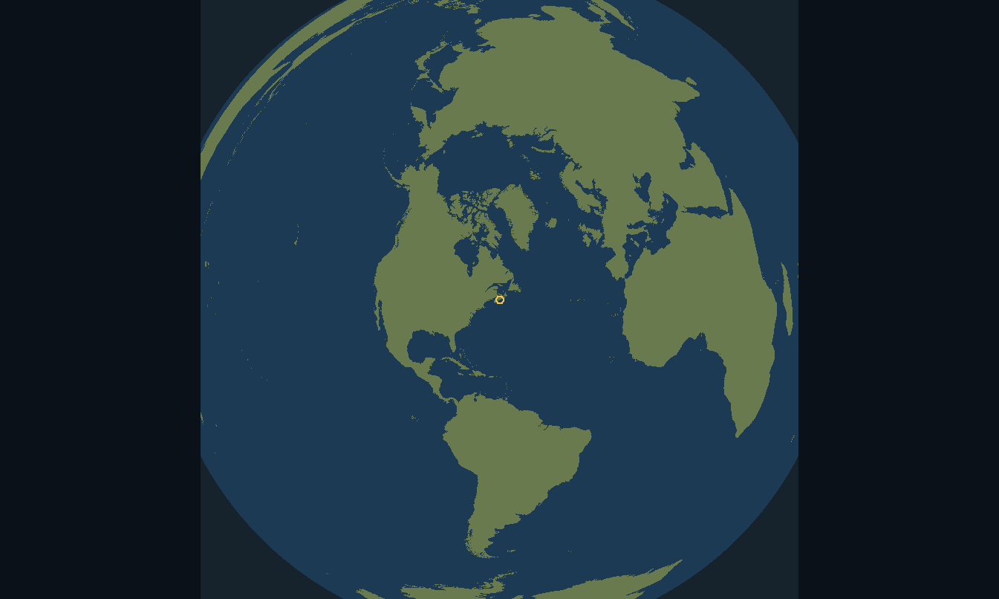
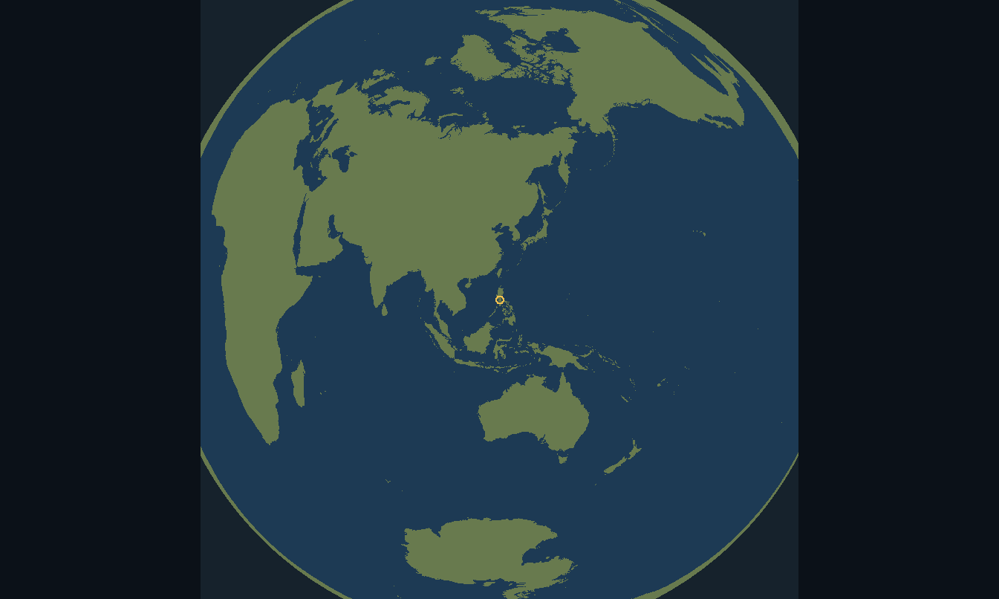
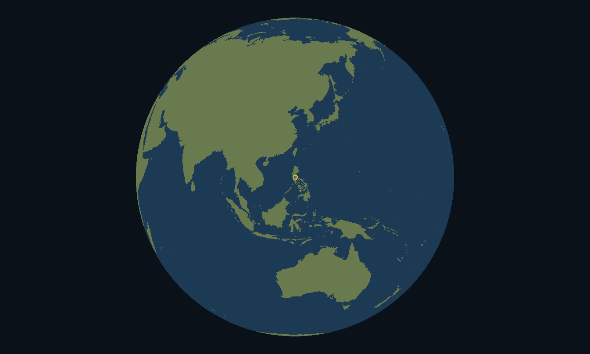
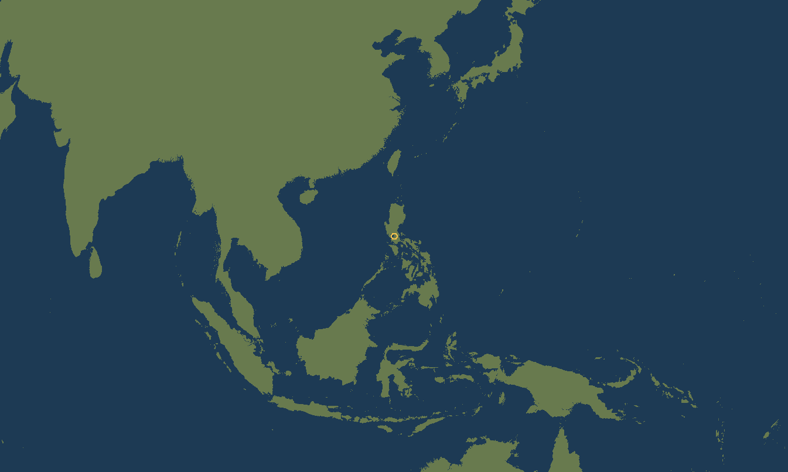
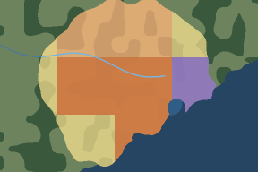
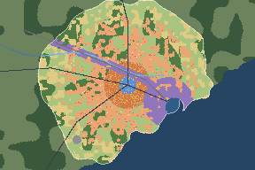

# The Earth's map as a globe, and ice and desert on the ground: a design study

*2026-10-11. A read-only design study; no game code was touched. Samuel sent three shots of the land office's expanded map on Earth: "see the issue? on top of that, if you play in philipines... well its disgusting". Then: "is a real globe too much?", "so basically scrolling makes it look flat right? and orientated right? cause map generation does required a flat surface", and "ok so do the design study or md required for it, and then add it to the list of batches the implementor will someday reach". He answered §5 at 10:26: "yes but add to that that the wasd or up down side keys span the map as well" - every recommendation taken, and panning with the keys added (§3.11) - and at 10:28 kept the arrows for the clock: "ya arros only for speed". At 10:29 and 10:31 he added a small map always in view, and asked how a big city keeps from drawing as "a blob of blue and a blob of purple" (§8; its mockup is the artifact "Minimap Study", https://claude.ai/artifact/9f5Q9H38WtXWauoV57wmtQ).*

*The code was read at 0.7.123 (commit 9605b25, `main`, 2026-10-11 09:27): `EarthProj`, `EarthTerrain`, `EarthData`, `EarthSite`, `World`, `MapFrame`, `MapTiles`, `ui/MapView`, `ui/FoundingScreen`'s globe, `CityLand`, `TileRaster`, `LandMap`, and `tools/earth/` (FORMAT.txt, bake.py). The prototype (`globe/globe-prototype.py` beside this note, a design aid in Python) draws the map both ways on real coasts and measures the handoff; its boards are the pictures in `globe/`. It uses GLOBE's 30″ land mask (the Earth study's prototype data), not `earth-1.bin`: the file is not in git and its release is not on GitHub yet (§6.1), so the boards show land and sea only. A frame's cost was timed in Java on the cloud machine (2 cores). Figures marked (est.) are estimates; the rest are measured or derived, with the sum shown.*

*Kept in the repository under `docs/studies/`, with its prototypes and boards beside it (Samuel, 10:40: "just put them on github no? thats where studies will be"). The earlier studies it cites (`spec-earth.md` and the others) are in the claude.ai project "Civic Ledger: Java Game", under `claude/`.*

---

## 0. In one page

**Three things are wrong with the Earth's map, and none of them is in the model.**
- **Ice and desert read as grass.** Antarctica and the Sahara are both "Grass" on the hover. The map has the generated world's five kinds of ground; the Earth data marks ice and desert, but only the founding card reads them. Ice as a kind of ground was decided on 2026-10-08 (spec-earth's E14) and never built.
- **The planet is cut by a square.** The world is a square 22,610 km a side; the whole planet, drawn round the city, is a disc 25,484 km across. The square leaves out 8.9% of the planet, which spec-earth §2.1 designed and the model is right to keep. The map, though, draws the cut: Antarctica stops on a ruler line, about 80.4°S straight south of a city at Halifax's latitude.
- **The far side is smeared round the rim.** The disc's edge is the city's antipode. A quarter of the planet lies more than 120° from the city and is drawn in the outer 13.4% of the disc's radius, at half its depth and twice its width or worse. From Manila the antipode is on the Bolivia–Brazil border, so most of the Americas becomes the rim.

**The fix is a globe when zoomed out and the city's plane when zoomed in.** Past a handoff, the map draws the planet as a globe seen from space (orthographic), the way the founding screen's globe already does (E4). Closer than the handoff it draws today's map, the city's own plane, unchanged.
- **The handoff is at 16 plots a pixel (0.48 km).** There the globe facing the city and the plane differ by 0.34 px at worst across the 1,345 × 806 expanded map, so the swap cannot be seen.
- **The orientation lines up.** Both are drawn round the city, so every place is in the same direction from the city in both. A globe looking at a point 300 km away is turned up to 2.7° from the plane there, so near the handoff it turns to the plane's up. Turned, the two differ by 1.16 px at 300 km.
- **Close views stay near the city.** Closer than the handoff, the view stays within 300 km of the city (a dial). Elsewhere on the planet the wheel stops at the handoff, 0.48 km a pixel.
- **The globe is drawn by the far view's own rule.** That is the far view's ground, rivers and dithered forest, through an orthographic camera instead of the plane's. A picture of the whole planet at 4′ serves the widest views. A frame from it measured about 100 ms on one cloud thread, so it turns live while dragged.

**Nothing in the model moves.** The plane, the plots, the square and its totals, the fields and saves stay as they are; map generation still runs on the flat plane. Generated worlds keep today's flat map.

**Added at 10:31: a minimap and district pictures (§8),** two batches, MM1 and MM2, which need nothing from the globe and can go first.

**Three batches for the globe, after Earth's E5:**
- **E7: ice and desert as kinds of ground**, on every map and in the model's rules.
- **E8: the globe's model half**, pure: the globe's frame, the camera in the far view, the planet's picture, and a harness.
- **E9: the globe on screen**: the land office's map and the founding screen on one globe.

**Samuel took every recommendation (§5, 10:26)** and added one thing: **W, A, S and D pan the map** (§3.11); the arrows stay the clock's speed.

---

## 1. What the shots show, measured

The prototype draws the expanded map at its widest, 28.05 km a pixel (`MapFrame.leastScale()`: the world's 22,610 km across the 806 px of the 1,345 × 806 view). The first board reproduces Samuel's third shot: the flat sides, the green ribbon on the top-left rim and Antarctica cut straight. The second is the Philippines.

### 1.1 Ice and desert are grass
- **The map's kinds of ground** are `World`'s five: GRASS, FOREST, FRESH, SALT and SAND (the beach). `EarthTerrain` makes every dry plot that is not beach or forest GRASS, and `LandMap`'s hover names it "Grass". Samuel's hovers: 323 km south-west of Showa Station (the Antarctic ice sheet) and 192 km north-east of Fada (the Sahara), both "Grass".
- **The data knows both.** Each 2′ land-cover cell (3.7 km) of `earth-1.bin` carries bit 6, snow and ice on half its land or more, and bit 5, bare ground on half its land or more (FORMAT.txt). The bake sets the ice bit on all of Antarctica's land, which WorldCover does not cover south of 60°S (`bake.py`, `LC_NODATA | LC_ICE`).
- **Only the founding reads them.** `EarthSite` refuses ice and warns of a desert, and `FoundingScreen`'s globe colours ice its own white and a desert the beach's sand.
- **Ice was decided** on 2026-10-08 (spec-earth §5, E14): "a sixth ground class: land, never dry, never built on, never a founding site". It counts in a holding's whole area only, and the painter gives it its own white. The todo carries it as E6, "his call; not scheduled". This study schedules it as E7.

### 1.2 The square
- **The cut.** The square's half-side, 11,305 km, is reached 125.05° (13,905 km) from the city along its axes. Straight south of a city at 44.65°N the land stops at 80.4°S; from Manila the cut falls across Antarctica on the far side of the pole, at 69.5°S on the meridian of 59.0°W.
- **What the square leaves out:** 45.6M km², 8.9% of the planet, the four caps of the disc past its sides (as spec-earth §2.1 measured).
- **Why there is sea past the cut.** `MapFrame` keeps the far nodes to the world, but a node that starts inside it runs past the edge, and `EarthTerrain.farTerrain()` classes every pixel past `World.SIDE` SALT. So below the ruler line in Samuel's first shot there is a band of sea up to the node's edge, then nothing.
- **Nothing in the model is wrong here.** The world's totals are the square's by design ("of the world's iron" means the square's).

### 1.3 The rim
Lambert's equal-area projection keeps every area true, so the far side keeps its area but not its shape. A place c degrees from the city is drawn cos(c/2) as deep as it is and 1/cos(c/2) as wide:

| from the city | drawn as deep | as wide | where on the disc |
|---|---|---|---|
| 90° | 0.707 | 1.41× | the outer 29.3% of its radius |
| 120° | 0.500 | 2.00× | the outer 13.4% |
| 150° | 0.259 | 3.86× | the outer 3.4% |
| 170° | 0.087 | 11.5× | the outer 0.4% |

- **From Halifax** the antipode is at 44.6°S 116.4°E, south-west of Australia; Perth is 167° away and Sydney 151°, at bearings from 280° (Sydney) round to 2° (Perth). Australia is the ribbon on the top-left rim of Samuel's shots.
- **From Manila** the antipode is at 14.6°S 59.0°W, on the Bolivia–Brazil border. Mexico City is 128° away, New York 123°, Bogotá 156°, Lima 162° and São Paulo 165°, so South America is drawn as a thin ring round the whole edge, and North America is stretched along the top-right rim (the second board, §1).

---

## 2. What is already there: the founding globe

E4 (0.7.121) gave the founding screen a globe (`FoundingScreen.Globe`, banner THE GLOBE). It is already this study's design, on a smaller canvas:
- **Wide**, from the whole planet to 4 km a pixel (`GROUND_KM_PX`): the planet orthographic, from a picture of it made once at 12′ (`TEXEL_ARCMIN`, 1,800 × 900 texels) out of the 4′ layers. Ice and desert are marked; a desert takes the beach's colour.
- **Close**, from 4 km a pixel to 150 m: the far view's ground (`MapTiles.nodeTerrain()`) on an Earth world centred on the view, the spot's own world while the view is centred on it.
- **The handoff** at 4 km a pixel: on its 560 × 270 canvas the two drawings part by 1.50 px at worst (the prototype).
- **Drawn on a worker:** the newest view asked for is drawn and the rest dropped; a drag slides the last picture until the new one is drawn.
- **Its arithmetic is in the screen:** `orthoInverse()`, `orthoForward()`, `texture()`, `globePixels()`, `groundPixels()`. Nothing in the model can hold it with a harness.

The land office's map needs the same thing at a bigger size, so the study moves the founding globe's arithmetic into the model and gives both screens one globe (E8, E9).

---

## 3. The design

### 3.1 Three pictures, by how close the view is
On an Earth world the expanded map draws one of three, by its scale:

| tier | scale (expanded map) | drawn from | while dragging |
|---|---|---|---|
| **PICTURE** | the whole planet (17.6 km a pixel, 0.9 of the view's height, as the founding globe's `MOST_KM_PX`) down to the picture's texel, about 7.4 km | the planet's picture (§3.6), each pixel's orthographic inverse then its texel | redrawn live (§3.6) |
| **GROUND** | 7.4 km down to the handoff, 0.48 km (16 plots) a pixel | the far view's own rule through an orthographic camera (§3.5), in pieces on the worker, like the far nodes | the last picture slid, the founding globe's way |
| **PLANE** | closer than the handoff, within REACH of the city | today's map: L0, L1, L2 and the far nodes under 16 plots a pixel | as today |

- **Generated worlds** keep today's map at every scale. They are a flat square, not a planet.
- **The small map** in the land office (600 × 400) opens on the city's ground and never zooms, so it never leaves PLANE.

### 3.2 The handoff
Both drawings are azimuthal round the city. A place an angle c from the city is drawn 2R sin(c/2) out on the plane and R sin c out on the globe, which differ by about R c³ / 8. A view of half-diagonal D pixels at k km a pixel therefore parts by about D³ k² / (8R²) pixels at its corners, and parts by half a pixel at k = 2R / D^1.5.

Measured on the prototype, the plane against the globe facing the city, at worst across the canvas:

| km a pixel (plots) | expanded map, 1,345 × 806 | founding globe, 560 × 270 |
|---|---|---|
| 0.48 (16) | 0.34 px | 0.02 px |
| 0.96 (32) | 1.37 px | 0.08 px |
| 1.92 (64) | 5.59 px | 0.34 px |
| 4.00 | 26.6 px | 1.50 px |
| 8.00 | 236 px | 6.31 px |

- **The dial:** the handoff at **16 plots a pixel** (0.48 km), a power of two the far nodes already use (`MapFrame.nodePlots()`). Half a pixel at the corner of the expanded map falls at 0.58 km, so 16 plots is under half a pixel there. On a 1,920 × 1,080 view it parts by about 1 px (est., by the formula).
- **The swap** crossfades over one notch (est.). That hides the third of a pixel and the change of tier.
- **The founding globe** may keep its 4 km on its smaller canvas (1.50 px), or take 2.3 km for half a pixel (★ in E9).

### 3.3 Which way is up
- **When wide, the globe is north up,** as the founding globe is, and a drag turns it.
- **The plane's up is the city's north.** At a place away from the city, north on the plane is turned from straight up, which a north-up globe looking there is not. Measured going east from Halifax: 0.9° at 100 km, 2.7° at 300 km, 4.4° at 500 km and 8.7° at 1,000 km. The city itself is never turned.
- **So the globe turns to the plane's up as it nears the handoff.** Over the last two notches before it (est.), and only when the view's centre is within REACH (§3.4), the globe's roll eases from north to the plane's up at the view's centre. A globe looking farther away never hands off and stays north up.
- **Turned to match, the two part by,** at 0.48 km a pixel on the expanded map, at worst over five bearings: 0.36 px at 100 km from the city, 1.16 px at 300 km, 2.3 px at 500 km and 6.7 px at 1,000 km (the same from Halifax and from Manila).

This is what Samuel asked: scrolling in makes it flat and oriented right. North is the same way, and every place is in the same direction from the city on both.

### 3.4 Where close views go: REACH
- **Closer than the handoff, the view's centre stays within REACH of the city.** A pan at that scale stops at it. The dial is **300 km** (1.16 px at the swap), or farther when the city's own land, its listed offers and the fields the map marks reach farther, plus 50 km round them (est.). A city of billions spans a continent, and its swap is then a few pixels.
- **Away from the city, the wheel stops at the handoff,** 0.48 km a pixel. The ground there is the far view's, with its rivers and lakes, but no plot of the city's.
- **The alternative (Q3)** is the founding globe's own: any spot to 150 m, on an Earth world centred on the view. Its seeded detail and its fields are another world's, not the city's, so a field drawn there would not be one the city could buy. The study recommends the stop.

### 3.5 One ground rule, three cameras
`EarthTerrain.farTerrain()` classes each far pixel from its latitude and longitude (`classAt()`) and strokes the rivers and small lakes from their vectors (`strokeWater()`). Only two things tie it to the plane:
- **where a pixel is on the planet,** `proj.latLonOfPlot()` or the 8-pixel blend;
- **where a river's vertex lands,** `place()` through the plane, and which 1-degree tiles a node needs, `nodeTiles()` from the node's edges.

E8 puts both behind a camera with three implementations:
- **the city's plane** (today's, byte for byte);
- **a latitude–longitude grid,** to make the planet's picture;
- **orthographic round a view centre, with a roll,** for the GROUND tier.

`classAt()` already works from latitude and longitude. At 16 plots a pixel and wider, every noise octave (the widest is 2^`NOISE_HI` = 16 plots) is no wider than a pixel and taken at its mean, so the plot coordinates it is handed matter only to the forest's dither. On the globe the dither's hash comes from a fixed latitude–longitude grid at the pixel's scale, so the forest does not shimmer as the globe turns (est.). Rivers keep `FAR_RIVER_SHARE`: a run is stroked only if it is that share of a pixel wide.

- **A cheaper GROUND tier near the city (★ E9):** within REACH, the plane's far nodes, already cached in plot space, can be reprojected onto the globe pixel by pixel instead of drawn again. It costs about 100 ns a pixel (est., from §3.6's timing) and draws exactly the plane's ground, so the swap shows only the projection's third of a pixel.

### 3.6 The planet's picture
- **A class a texel at 4′, the far layers' own grid:** 5,400 × 2,700 texels, one byte each (14.6 MB). It is made by the far rule through the grid camera: ice and desert (E7), the forest dithered, and the rivers wide enough for a 7.4 km pixel stroked (`FAR_RIVER_SHARE` × 7.4 km, about 89 m and wider). The founding globe's 12′ picture of blended colours (6.5 MB as ints) goes.
- **Made once for each Earth file,** on a worker, the first time an Earth map or the founding globe needs it; 12′ first, then 4′ (est.). It is never saved. Its cost (est.): one far-layer read a texel, plus decoding every river tile once, which E5 measured at about 1 s for the whole world's first view. That makes about 2 s on the worker, once.
- **A frame from it, measured:** the 1,345 × 806 view, each pixel's orthographic inverse then its texel, takes 96 to 102 ms on one cloud thread and 50 to 52 ms on two, whether the picture is 12′, 6′ or 4′. The trigonometry costs; the picture's size does not. Cut into bands of rows, one a core, and at half resolution while dragging (est. 25 ms on one thread), the globe turns live.

### 3.7 What else the globe draws
- **The city:** a ring at its centre, at every scale. Its edge (`LandMap`'s outline) is drawn through the camera once it is at least 4 px across (est.).
- **The fields, the boats, the sea routes and the lanes:** drawn through the camera in the GROUND tier within REACH, each vertex projected; hidden in the PICTURE tier, where they are smaller than a pixel. The freight study's real routes to real ports would draw here later.
- **The legend** on the globe lists the kinds of ground and the city's ring; the whole legend is back from the handoff in.
- **The scale bar** is true at the view's centre only, and says so ("at the centre").
- **The hover:**
  - its point on the planet comes from the camera;
  - its ground is the class drawn there;
  - whose: the plane's own answer within the square and within REACH (`EarthProj.forward()` to the plot, then `LandMap` as today), else "Not the city's";
  - the nearest place and the province: `LandMap.earthWords()` finds them from a plot today; the globe asks by latitude and longitude, so it needs a variant that takes them, beyond the square too.
- **Fit (0)** shows the whole planet, facing the city, north up. The map still opens on the city (`OPENING_MARGIN`).
- **The world off the city's land** is dimmed, as the expanded map dims it today.

### 3.8 The founding screen on the same globe
E9 moves the founding globe onto the model's globe frame and the planet's picture, so both screens look the same: the same classes, the same ice and desert, and rivers on the founding globe's wide view for the first time. Its close tier (a world centred on the view, to 150 m) stays, because there is no city yet. Its desert loses the beach's colour for DESERT's.

### 3.9 Ice and desert on the ground (E7)
- **The rule** is spec-earth §2.3's with two more kinds, in this order: SALT, FRESH, then **ICE**, SAND (the beach), FOREST, **DESERT**, GRASS.
- **The edges.** Each kind's bit is read as 0 or 1 at its 2′ cell, interpolated between the cells' centres as the shares are, and tested against ½ plus its own noise, as the coast is (`COAST_FRAY`). Its edge is then frayed by a plot or two instead of drawn in 3.7 km squares (est.; a harness measures it).
- **Ice:** land, never dry, never built on, never a founding site (E14 as decided). It counts in a holding's whole area only, and has its own white (the founding globe's `0xffdfe7ee`).
- **Desert:** dry ground that every rule of the model treats as grass (Q1). Only its colour, a warmer tan than the beach (est.), and its name on the hover and legend differ. Mechanisms for it, if any, come later and are never multipliers (E12).
- **In the code:**
  - `World` takes the next two bytes for ICE and DESERT, never renumbering the five.
  - Every test for dry ground uses one rule, a `World.dry(cls)` (est. name). Today the test is written out in several places (`DistrictPlan`, `CityMap`, `CityRuns`, `GridConversion`'s counts), each as GRASS, FOREST or SAND.
  - `CityLand`'s counts by class (`long[5]`) keep the five areas: DESERT counts with grass, ICE in the whole area only.
  - `TileRaster.GROUND` gets two colours, `LandMap` two names, and the legend two entries (33 + 2 = 35, within its three columns of 12).
- **The founding card** reads the same rule. `EarthSite.onIce()` and the plot's class then agree at the site, and a harness says so.
- **The fields under ice** stay as E3 draws them (Q2). Nothing is built on ice, so a field under Greenland's ice can't be mined.

### 3.10 What does not change
- **The model:** the plane, the plots, the block grid, the square and the world's totals, the cells pass and E3's fields, map generation, the land office, saves.
- **Saves:** no format bump is expected. Desert is dry as grass is, and ice appears only on Earth ground no city has owned. If an Earth holding's saved areas would read wrongly, the standing rule applies: bump `SAVE_FORMAT` and raise the floor.
- **The traces:** every generated trace stays byte-identical. The Earth baseline, `pte07121` (Rotterdam), is expected to stay too, since its city owns no ice or desert; E7 checks.

---

### 3.11 Panning with the keys (Samuel, 10:26 and 10:28)
"yes but add to that that the wasd or up down side keys span the map as well", then, told that the arrows are the clock's speed: "ya arros only for speed".
- **W, A, S and D pan the expanded map,** at every scale and on generated worlds too.
  - Held, a key moves the ground at a steady speed on the screen, the same at every zoom (est. 600 px a second).
  - Two keys at once move it diagonally.
  - On the globe a key turns it as a drag of the same pixels would; on the plane the pan stops at REACH, as a drag does.
- **The arrows stay the clock's speed,** as `UserInterface`'s key filter has them (LEFT AND RIGHT ARE THE LADDER), on the map as everywhere else in the city. Up and down are left as they are. W, A, S and D are bound to nothing today.
- **Not while typing** (the filter's own `typing` test), and not on the land office's small map, which never pans.
- **The founding globe** takes the same four keys while it has the focus, but not while the name is being typed (★).
- **Where it goes.** The held keys set a velocity in `MapView`, and the view's frame pump (`pump`, already running for the boats) moves `MapFrame.pan()`, or the globe frame's turn, by it each frame. The arithmetic - pixels a second, the clamp at REACH - goes into the frames, so a harness holds it: a key held for a second moves the ground the dial's pixels at any zoom.
- **It needs no globe.** On today's flat map the keys are screen-only, so they can ship on their own ahead of E9, as a small batch.

## 4. The batches

| batch | what | harness | traces |
|---|---|---|---|
| **E7** | ice and desert as kinds of ground: `World`'s two classes, `EarthTerrain`'s rule with their frayed edges, one rule for dry ground, `CityLand`'s areas, `TileRaster`'s colours, `LandMap`'s names, the legend; the founding globe's desert in DESERT's colour | EarthTerrainCheck: each kind's share per 1-degree cell within its bound of the data's, its edge frayed, ice never dry or built on, desert dry wherever grass is, the founding card's ice agreeing with the plot's | generated byte-identical; `pte07121` expected identical |
| **E8** | the globe's model half, pure: a `GlobeFrame` in the model (centre, scale, roll; zoom at the pointer, turn, fit; the tiers, the handoff and REACH dials; `latLonAt()` and `at()`), the orthographic projection moved into `EarthProj`, the camera through `EarthTerrain`'s far rule, the planet's picture (`GlobePicture`, est. name) | GlobeCheck (new): the orthographic round trip; zoom at the pointer keeps the point under it; the plane and the globe part by under half a pixel at the handoff and under the bound at REACH with the roll eased; the picture's land per 1-degree cell within its bound of `far.land`'s; the plane's camera byte-identical to today's far nodes; a frame within a time bound | byte-identical: nothing on screen yet |
| **E9** | the globe on screen: W, A, S and D pan (§3.11; can go first, alone); `MapView`'s three tiers on Earth, the crossfade, the roll's ease, the REACH stop, the hover, the legend, the scale bar's words, Fit; the founding screen on `GlobeFrame` and the picture; ★ the founding globe's handoff, ★ the GROUND tier reprojected near the city | MapCheck: the hover's words on the globe equal the plane's at the handoff for the same point; the legend's entries by tier; the rest by eye on the PC | byte-identical |

| **MM1** | district pictures (§8.2): a 32 × 32 picture of each built district from its drawn plan, kept by its stamp and redrawn only when it changes; the far nodes draw from them where a district is 4 px or more, its mix dithered where smaller; the highways, railway and the city's edge at least a pixel wide | MapCheck: a picture's shares within their bound of the district's counts; an unchanged district keeps its picture; a month redraws only the districts that changed; a far node within MapCheck's time bound | byte-identical |
| **MM2** | the minimap (§8.3): a stamp at the rail's foot, a preview on hover, a click to the expanded map; the city's built-up ground fitted | by eye on the PC | byte-identical |

E7 can go first and alone. E8 needs E7, because the picture carries ice and desert, and E9 needs E8. MM1 and MM2 need none of them; MM2 needs MM1, and E9 draws the city on the globe near the handoff from MM1's pictures. Each is one fresh implementer and a docs pass.

---

## 5. Decisions (Samuel, 2026-10-11, 10:26: "yes")

1. **Q1. Desert: its own kind of ground, treated as grass by every rule.** *Decided, as recommended.* Only its colour and its name differ; a mechanism can come later (E12). The alternatives: a colour only, with the hover still saying "Grass"; or no desert at all.
2. **Q2. Ice as E14 decided, with E3's fields left where they are.** *Decided, as recommended.* A field under ice can't be mined, because nothing is built on ice. The alternative, no fields under ice, changes E3's Z and the Earth baseline.
3. **Q3. Close views only near the city: past the handoff, within 300 km.** *Decided, as recommended.* Elsewhere the wheel stops at 0.48 km a pixel. The alternative is the founding globe's way, any spot to 150 m on a world centred there, whose ground and fields are not the city's.
4. **Q4. North up when wide, turned to the plane's up near the handoff.** *Decided, as recommended.* The turn is at most 2.7° within 300 km of a city at Halifax's latitude, and nothing at the city. The alternative: the globe always in the city's frame, so that looking at Japan from Halifax, north is not up.
5. **Q5. The globe drawn as the far view draws** (classes, dithered forest, rivers), both globes the same. *Decided, as recommended.* The alternative: the founding globe's blended colours.
6. **Q6. The handoff at 16 plots a pixel (0.48 km).** *Decided, as recommended.* The alternative, 32 plots (0.96 km), parts by 1.37 px but draws fewer plane nodes.
7. **Q7. The founding screen onto the same globe (E9).** *Decided, as recommended.* The alternative: leave it as E4 built it.
8. **Q8. Generated worlds keep the flat map.** *Decided, as recommended.* They are a square world, not a planet.
9. **Q9. W, A, S and D pan the map; the arrows stay the clock's speed.** *Samuel's addition* (§3.11, 10:26 and 10:28). ★ The founding globe takes the four keys too.

10. **Q10. The minimap at the rail's foot**, a stamp with a preview on hover. *Shipping as the default (★); his to change* (§8.3). The alternatives: a card at the page's bottom left, or the top of the City overview drawer.
11. **Q11. The expanded map's far view drawn from the district pictures too.** *Shipping as the default (★).* The same blobs are on it today.
12. **Q12. No boats on the stamp.** *Shipping as the default (★).* At 480 m a pixel a boat is under a pixel; the preview and the expanded map keep them.

---

## 6. Found on the way

1. **The `earth-1` release is not on GitHub.** `get-earth.bat` downloads `releases/download/earth-1/earth-1.bin`, and that URL answers 404. The repository has releases up to 0.7.92 and no tag `earth-1` (checked 2026-10-11 through the REST API). `git-workflow.md` says Jerus makes the release on GitHub's website; until he does, a fresh clone and `Build EXE.bat` can't get the file. A PC that already has it is unaffected.
2. **The square's overhang is painted sea** (§1.2). On the generated world that is "the sea beyond the world's edge", as it always was; on Earth it draws ocean over Antarctica. The globe never shows it.
3. **The founding globe paints a desert with the beach's colour** (`FoundingScreen.texture()`), the only place the game draws a desert today.
4. **Ice was decided, then listed as undecided.** Spec-earth §5 E14 decided ice; the todo's E6 calls it "his call; not scheduled". E7 takes it, and E6 keeps the salt-lake list and the heights.

---

## 7. The prototype

`globe/globe-prototype.py` (Python 3, numpy, Pillow, `global-land-mask`) draws the expanded map at 1,345 × 806, the five boards in `globe/`:
- **`today-<city>.png`:** the plane round the city as 0.7.123 draws it, the void off the planet and the stage off the world's square, at 28.05 km a pixel;
- **`globe-<city>.png`:** the globe at 17.6 km a pixel, for Halifax and Manila;
- **`globe-manila-8km.png`:** the globe at 8 km a pixel, about where the GROUND tier begins.

It then prints §1 to §3's measures: the square's cut and caps, the rim's table, the handoff's table on both canvases, and the turn and the swap away from the city. Land and sea only, from GLOBE's 30″ mask; the game's forest, rivers, lakes, ice and desert are not drawn. The colours are `TileRaster.GROUND`'s, dimmed about as the expanded map dims the world. `globe/GlobeBench.java` timed §3.6's frame.

## 8. A small map always in view, and a big city that does not blob (Samuel, 10:29 and 10:31)

"and on top of that, i think a small map always visible on the ui would be nice or no?", then "yes but also how do we fix the resolution issue, cause at a certain city size you might just see a blob of blue and a blob of purple and thats it". The mockup is the artifact "Minimap Study" (https://claude.ai/artifact/9f5Q9H38WtXWauoV57wmtQ), its boards drawn by `minimap/minimap-prototype.py` and gathered into the page by `minimap/mm_page.py` (the page is `minimap/minimap-study.html`, which opens from a clone) on an illustrative city of about a million: 4.5 by 3 districts (35 by 23 km), a port, a core, rings of homes, industry on the port and the railway. It is not a save.

### 8.1 Why a big city blobs
It is the far view's rule, not the screen's size. Past the painted tiles, `MapTiles.nodePixels()` paints each district (256 plots, 7.68 km) one tint over its owned dry ground (`tintOf()`):
- the kind of building that takes the most ground in it, homes drawn as flats where the district is densest;
- at `TileRaster.BLOCK_ALPHA` by how much of its ground is used (`BLOCK_FILLS`).

A city of a million on a dozen districts (est.) is a dozen squares at every size, on the expanded map's far view as much as on a small one. The mockup's first board shows it: the core, the homes and the port as three flat squares. Today's rule on the left, district pictures (§8.2) on the right, at the hover preview's 288 × 192:

 

### 8.2 District pictures
- **Each built district gets a 32 × 32 picture of itself,** a pixel for 8 plots (240 m), drawn from the painter's own plan for it (THE DRAWN PLANS, with what is carried to it), so the picture agrees with the close map.
- **A picture's pixel** takes one of its 64 plots' colours: the plot picked by a fixed hash from its plots ranked by class. A pixel's colour is then drawn in proportion to what stands on it, and stays put from month to month.
- **Kept with the district's stamp** (its counts, its purchases, its plan), and redrawn only when that changes: a few districts a month, on the map's worker. About 4 KB a district.
- **Cost (est.):** a plan is about 2 ms, 22 ms at the slowest (DistrictPlan's measures), and its ground about 8 ms on the generated world (`CityMap.measure()`'s 64 tiles). That is 10 to 30 ms a district, so a dozen-district city costs about 0.4 s once at load, and then only the districts that change.
- **How the far view uses them:** where a district is 4 px across or more on screen, a far node samples its picture instead of the tint. Smaller than that, its pixels are dithered by its classes' shares (the mockup's second rule: honest about the mix, blind to where things are). The highways and the railway (`CityRuns`) and the city's edge are drawn as lines at least a pixel wide at every scale, so the city keeps its shape when it is tiny.

### 8.3 The minimap
- **A stamp at the foot of the rail,** above the gear, as wide as the rail allows (about 66 × 44, est.). It covers nothing and is on screen from every tab.
  - The header is full: it fits the money block and five tiles to a 1,280-pixel window.
  - Anything floating over the page hides what is under it; the income dome once hid the Memorial Cemetery's price, which is why the time controls stopped floating.
- **On hover,** a preview beside it, 288 × 192 (est.); **a click** opens the expanded map on the city.
- **What it frames:** the city's built-up ground (its districts with buildings) and a margin, not every plot it owns, so bought sea or a far deposit does not shrink the city to a dot.
- **When it is drawn:** at the month's end, from the district pictures, so it costs a few milliseconds (est.). No boats on the stamp (Q12).
- **On Earth** it is the city's plane, never the globe.
- **The other places** (a card at the page's bottom left; the top of the City overview drawer) are in the mockup with why not.

## Sources

- J. P. Snyder, *Map Projections — A Working Manual*, USGS Professional Paper 1395 (1987): the orthographic and Lambert azimuthal equal-area projections, forward and inverse. https://pubs.usgs.gov/pp/1395/report.pdf
- GLOBE 30″ land mask, as packaged by `global-land-mask` (the prototype's data, as in spec-earth): https://pypi.org/project/global-land-mask/
- The code at 0.7.123 and `tools/earth/FORMAT.txt` for the data's layers and bits; the project's `claude/spec-earth.md` for the projection, the square and E14; the project's `claude/iron-at-the-worlds-price.md` §9 for E5's far-node costs.
