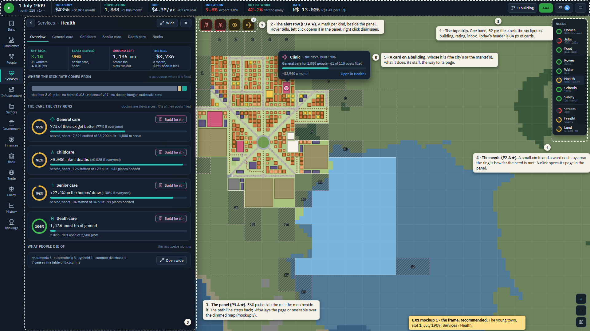
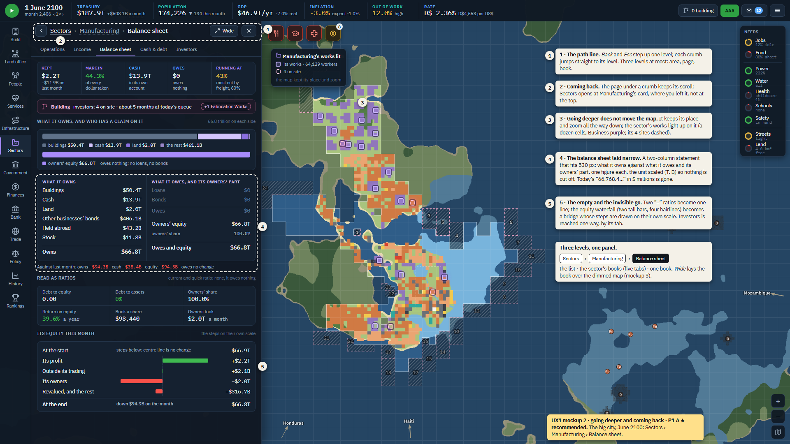
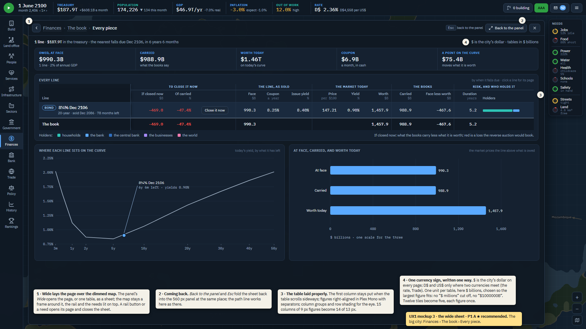
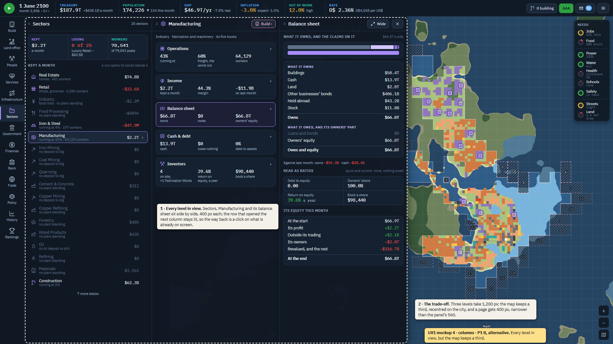
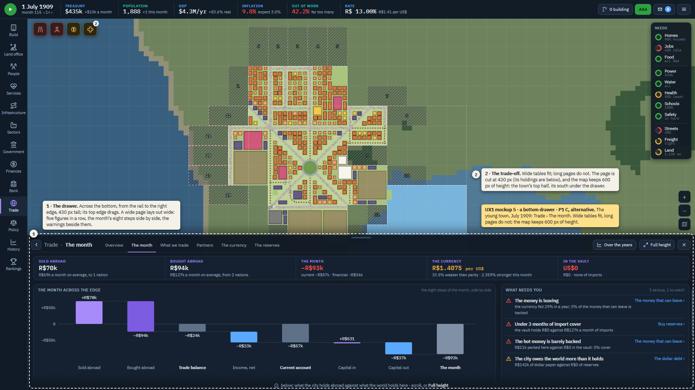
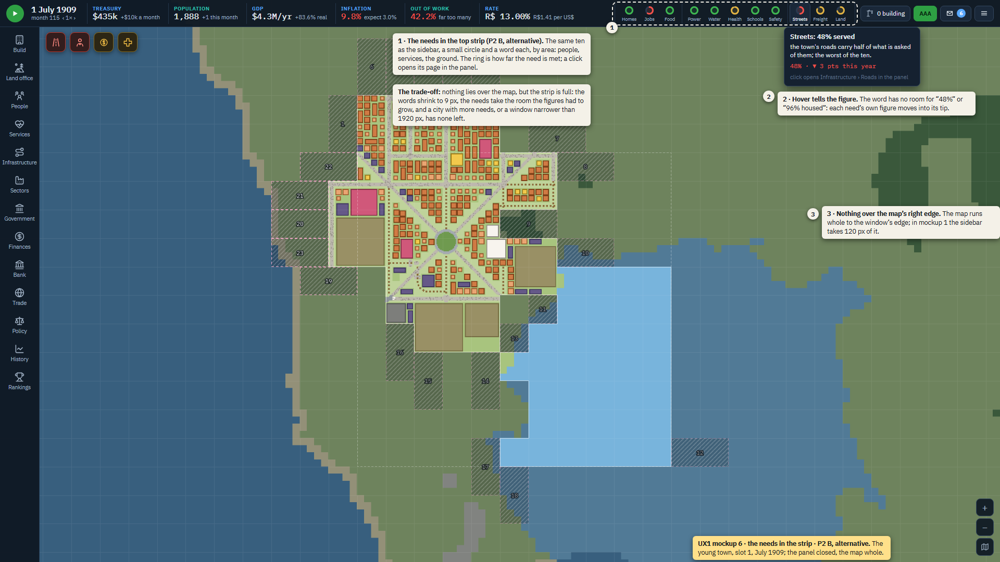
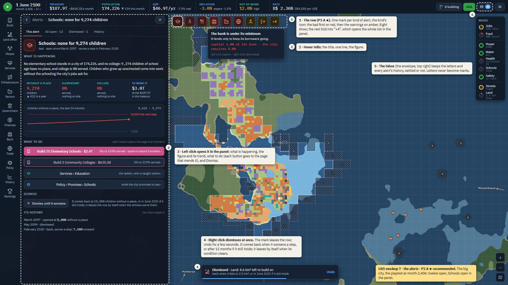
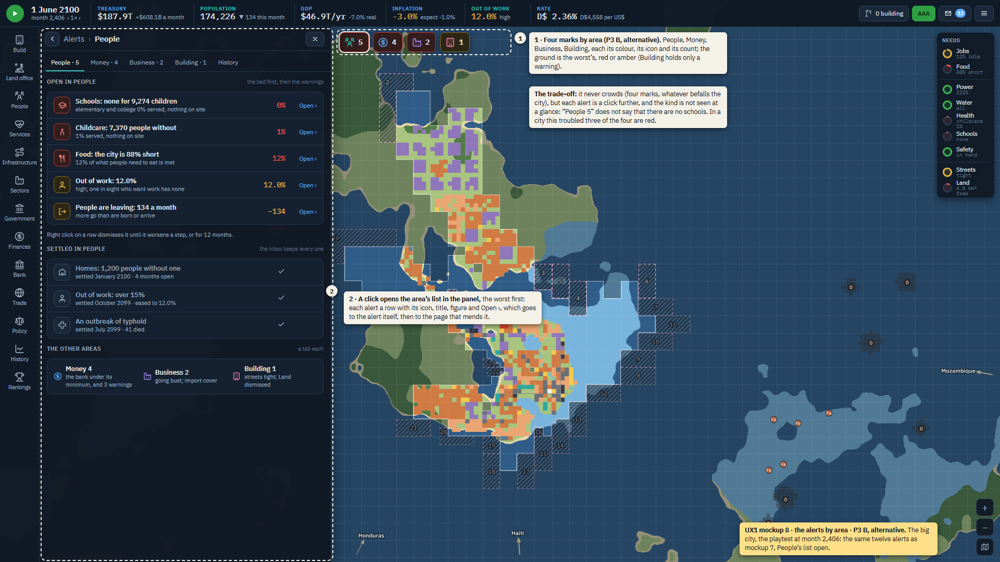
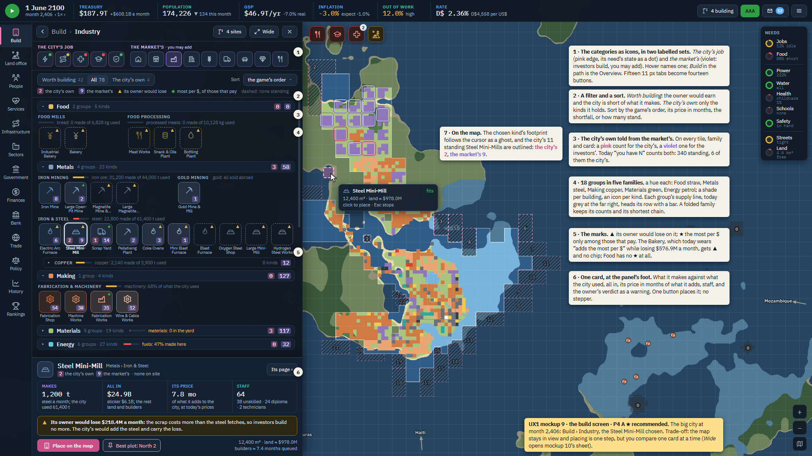
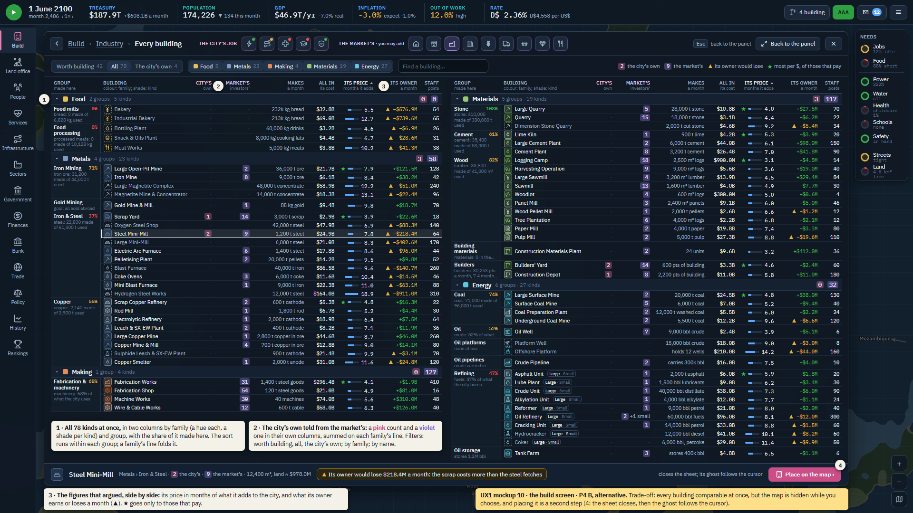

# UX1 - the interface rework's study: the map as the ground of every screen

Batch UX1, 2026-11-27. The notes are `docs/queue/UX1-notes.md`; the rows it plans are UX2 to UX13
(`docs/queue/UX2.md` ... `UX13.md`). Jerus's part is the four picks below; the rows are written to the
recommendations (★), and nothing waits on him.

The mockups are drawn in the game's own look over a real picture of the map at 1920x1080. The white
labels belong to the mockup, not the interface.

## The picks

**P1, where pages open.** ★ A: one panel beside the rail, a path line, Wide for big statements.

| A ★ the frame (Services > Health) | A ★ going deeper | A ★ the wide sheet |
|---|---|---|
|  |  |  |

| B, alternative: columns | C, alternative: a bottom drawer |
|---|---|
|  |  |

**P2, the needs.** ★ A: a sidebar of small circles and words (mockup 1, right edge). B, alternative: the
circles in the top strip.

| B, alternative: the needs in the strip |
|---|
|  |

**P3, the alerts.** ★ A: a mark per kind under the strip, eight then "+N"; left click opens, right click
dismisses; a dismissed alert returns a step worse or after 12 months. B, alternative: four marks by area.

| A ★ the alert row | B, alternative: by area |
|---|---|
|  |  |

**P4, the build screen.** ★ A: in the panel, families of groups, a tile per building with the city's and
the market's counts, one card, placing on the map. B, alternative: the whole catalogue wide.

| A ★ the build screen | B, alternative: the catalogue |
|---|---|
|  |  |

## What is here

- `audit-1-chrome-build.md` ... `audit-5-policy-history.md`: every page of today's interface read on three
  cities (the young town of slot 1, the playtest's city at 606 and 2,406 months), each area's five worst
  problems.
- `pictures/`: the audit's 36 clearest pictures of today's pages, `NNN-page--city.png`.
- `mockups/`: the ten mockups, each PNG beside its HTML; `lib/` is their frame (the palette, the fonts from
  `src/main/resources/fonts`, the icons read from `ui/Icons.java` by `icons2js.py`, the two map grounds).
  To render one: Edge headless, `--headless=new --user-data-dir=<a scratch folder> --window-size=1920,1080
  --screenshot=<png> file:///<html>` (from PowerShell; without its own profile Edge writes nothing).
- The pictures of every page come from `ui.PagePictures`; the harness that holds the window still is
  `UiSteadyCheck`.
